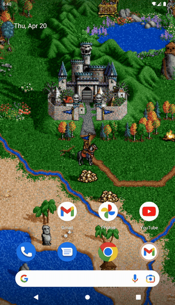

# fheroes2 Live Wallpaper

**fheroes2 Live Wallpaper** is a Live Wallpaper for Android that brings the world map of Heroes of Might and Magic II to your home screen.

It is based on [**fheroes2**](https://github.com/ihhub/fheroes2), an open source recreation of the Heroes of Might and Magic II game engine.

    

## Copyright

All rights for the original game and its resources belong to former The 3DO Company. These rights were transferred to Ubisoft.
We do not encourage and do not support any form of illegal usage of the original game. We strongly advise to purchase the original
game on [**GOG**](https://www.gog.com) or [**Ubisoft Store**](https://store.ubi.com) platforms. Alternatively, you can download a
free demo version of the game. Please refer to the [**installation guide**](docs/INSTALL.md) for more information.

## License

This project is licensed under the [**GNU General Public License v2.0**](https://github.com/ihhub/fheroes2/blob/master/LICENSE).
